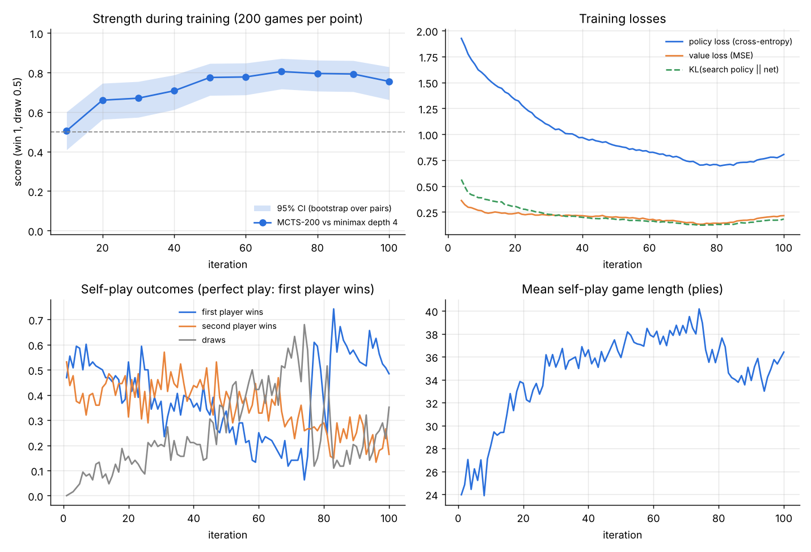
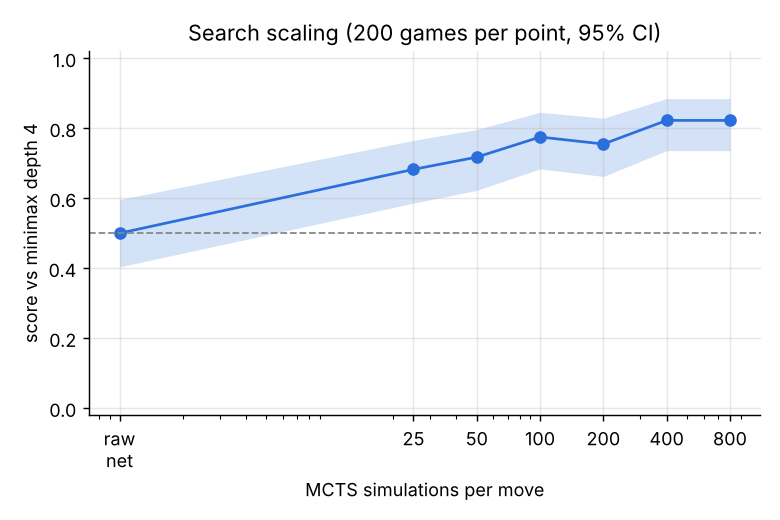

# Connect 4 Zero: um mini AlphaZero treinado do zero em CPU

Implementação do algoritmo **AlphaZero** (busca em árvore Monte Carlo guiada por uma rede neural de política e valor, treinada só por *self-play*) para o jogo **Connect 4 (Lig 4)**. Nenhuma estratégia humana é ensinada: o agente começa jogando ao acaso e aprende jogando contra si mesmo.

O modelo final foi treinado em **54 minutos numa CPU de 4 núcleos** e avaliado contra adversários clássicos e contra um **solver exato** do jogo, sempre com intervalos de confiança.

*Código e comentários em inglês; documentação em português.*

## Uma partida

O modelo (X, 400 simulações por lance) contra um minimax com poda alfa-beta de profundidade 4 (O), a partir do tabuleiro vazio. O modelo abre no centro e vence com uma linha horizontal no lance 31:

```
X . . O O . .
O . . X O . .
X O . O X X .
X X X X O O .      lances: 3333344443100404000665555111222
X O O O X X X
O X X X O O O
0 1 2 3 4 5 6
```

Para jogar contra ele: `python -m connect4_zero.play` (detalhes em [Como rodar](#como-rodar)).

## Resultados principais

Todas as partidas de avaliação começam de aberturas forçadas de 3 lances, sorteadas sem reposição e jogadas duas vezes (uma com cada cor). Score = (vitórias + 0,5 × empates) / jogos. Intervalos de 95%.

| Adversário | Só a rede | MCTS 200 simulações | MCTS 800 simulações |
|---|---|---|---|
| Aleatório | 0,99 | 1,00 | 1,00 |
| Guloso (ganha ou bloqueia em 1 lance) | 0,91 | 0,99 | 1,00 |
| Minimax profundidade 2 | 0,56 [0,46; 0,65] | 0,85 [0,76; 0,91] | **0,91** [0,84; 0,95] |
| Minimax profundidade 4 | 0,50 [0,40; 0,60] | 0,76 [0,66; 0,83] | **0,82** [0,74; 0,89] |

200 partidas por célula. Contra o minimax de profundidade 4 com 800 simulações: 157 vitórias, 15 empates, 28 derrotas.



**Leitura das curvas:**
- A força contra o minimax de profundidade 4 sobe de 0,51 (iteração 10) para cerca de 0,78 a partir da iteração 50, e depois fica estável dentro do intervalo de confiança (0,76 a 0,81). O treino entrou em platô na metade.
- As partidas de self-play ficam mais longas (24 para ~36 lances): os dois lados param de cometer erros táticos simples.
- Nas últimas 15 iterações o primeiro jogador vence mais partidas de self-play que o segundo (48 a 66% contra 13 a 32%). Isso é coerente com a teoria (o primeiro jogador vence com jogo perfeito), embora a série oscile bastante.
- As perdas de política e de valor sobem nas últimas ~20 iterações. A entropia dos alvos de política (0,57 para 0,62) e o KL entre rede e busca (0,13 para 0,18) aumentam, junto com a queda de empates no self-play. A força medida não cai, mas a causa não foi investigada.



A rede sozinha empata com o minimax de profundidade 4 (0,50). A busca melhora o resultado de forma consistente: 0,68 com 25 simulações, 0,78 com 100 e 0,82 com 400 ou 800. A rede dá a intuição e a busca corrige os erros táticos.

### O modelo redescobre a teoria de aberturas

O Connect 4 é um jogo resolvido (Allen, 1988; Allis, 1988): com jogo perfeito o primeiro jogador vence **somente** começando na coluna central. A linha "Solver" abaixo foi recalculada com o solver exato do projeto ([results/opening_solver.json](results/opening_solver.json)) e confirma esse resultado.

| Primeira jogada (coluna) | 0 | 1 | 2 | 3 | 4 | 5 | 6 |
|---|---|---|---|---|---|---|---|
| Solver (para o 1º jogador) | derrota | derrota | empate | **vitória** | empate | derrota | derrota |
| Política da rede | 1,5% | 3,3% | 0,9% | **89,2%** | 0,9% | 3,0% | 1,3% |
| Valor estimado pela rede | -0,35 | -0,36 | -0,23 | **+0,33** | -0,32 | -0,38 | -0,29 |

A rede aprendeu sozinha que só o centro é vantajoso (único valor positivo) e, com 1600 simulações, 99,4% das visitas na raiz vão para o centro. A ordem fina entre "empate" e "derrota" nas outras colunas não foi capturada (a coluna 6 tem valor maior que a coluna 4, por exemplo).

### Benchmark com o solver exato

Para medir a qualidade das jogadas com *ground truth*, o projeto tem um solver exato em C ([solver/c4solver.c](solver/c4solver.c)). Ele foi validado contra busca exaustiva em Python em 150 posições de final de jogo durante o desenvolvimento (40 delas ficam nos testes automatizados) e reproduz o valor teórico das 7 primeiras jogadas.

Com ele foram rotuladas 600 posições de meio de jogo (lances 10 a 34) em que a escolha importa: pelo menos uma jogada muda o resultado teórico. Por construção, todas são vitória (534) ou empate (66) para quem joga. A métrica é a fração de posições em que o jogador escolhe uma jogada que preserva o melhor resultado possível.

| Jogador | Jogadas que preservam o resultado teórico |
|---|---|
| Aleatório (valor esperado) | 39,2% |
| Guloso | 59,0% |
| Minimax profundidade 2 | 80,7% |
| Minimax profundidade 4 | 84,2% |
| **Modelo final, só a rede** | **75,3%** |
| **Modelo final, MCTS 50 / 200 / 800** | **82,7% / 85,8% / 89,0%** |
| Iteração 10, MCTS 800 | 86,0% |
| Iteração 50, MCTS 800 | 89,8% |

Leitura honesta:
- A rede sozinha joga abaixo do minimax de profundidade 2. Com busca, o modelo passa o minimax de profundidade 4 (89,0% contra 84,2%), mas a vantagem é de 5 pontos. As posições vêm de partidas entre minimax de profundidade 2 e 3, o que pode favorecer o minimax.
- Com 600 posições o erro padrão é de 1,3 a 1,8 pontos. A diferença entre a iteração 50 e o modelo final não é significativa, o que é coerente com o platô, mas não prova que sejam equivalentes.
- **Cabeça de valor**: num conjunto derivado das mesmas posições e balanceado entre vitória, empate e derrota (1.720 posições), a rede acerta o sinal em 65,5% dos casos decisivos (acurácia balanceada) e os valores médios ficam na ordem certa: +0,21 (vitória), -0,03 (empate), -0,29 (derrota). Ela sabe para que lado o jogo pende, mas está longe de saber o resultado exato.

## Como funciona

```
          ┌───────────── self-play (4 processos) ─────────────┐
          │  128 partidas em paralelo, MCTS em lote           │
 rede ───►│  PUCT + ruído de Dirichlet na raiz                │───► (estado, política MCTS, resultado, Q)
  ▲       │  playout cap: 25% dos lances com busca completa   │            │
  │       └───────────────────────────────────────────────────┘            ▼
  │                                                              janela de replay crescente
  └──────── SGD (AdamW, cosine LR): CE(política) + MSE(valor) ◄── aumento por espelhamento
```

- **Jogo** ([game.py](connect4_zero/game.py)): bitboard de 64 bits, com vitória detectada por 4 operações de *shift*. O estado é sempre representado do ponto de vista de quem joga, então a rede e o alvo de valor servem para os dois jogadores.
- **Rede** ([model.py](connect4_zero/model.py)): ResNet com 4 blocos residuais de 64 canais, cabeça de política (7 colunas) e de valor (tanh), 300 mil parâmetros. Na inferência a BatchNorm é fundida às convoluções.
- **MCTS** ([mcts.py](connect4_zero/mcts.py)): PUCT com *first-play urgency*, ruído de Dirichlet na raiz no self-play e reuso da subárvore entre lances. As folhas de **todas as partidas** são avaliadas num único lote da rede, o que torna o self-play viável em CPU. Uma regra tática barata (ganhar quando possível, bloquear ameaça única) restringe a priori dos nós via operações de bitboard.
- **Self-play** ([selfplay.py](connect4_zero/selfplay.py)): *playout cap randomization* (técnica do KataGo). Só 25% dos lances recebem busca completa (200 simulações) e viram exemplo de treino; os outros usam 40 simulações só para avançar a partida. Isso gera mais partidas, e portanto mais sinal de valor, pelo mesmo custo.
- **Treino** ([train.py](connect4_zero/train.py)): o alvo de valor mistura o resultado final *z* com o Q da busca (peso de Q de 0,5 para 0,2 ao longo do treino). A janela de replay cresce de 8 mil para 30 mil posições, há aumento de dados por espelhamento horizontal e o LR decai em cosseno.

## Metodologia de avaliação

- **Adversários de referência** ([baselines.py](connect4_zero/baselines.py)): aleatório; guloso; minimax com poda alfa-beta e heurística de janelas, profundidades 2 e 4. Profundidades ímpares e a 6 ficaram de fora porque, com essa heurística, não são mais fortes que a profundidade par imediatamente abaixo (medido em 98 partidas por par).
- **Pares de partidas** ([arena.py](connect4_zero/arena.py)): cada abertura forçada de 3 lances (343 possíveis) é sorteada sem reposição e jogada duas vezes, uma com cada cor. Não há partidas duplicadas.
- **Intervalos de confiança**: o par de partidas é a unidade independente. O intervalo é a união de um *bootstrap* sobre pares com um intervalo de Wilson sobre a média dos pares. É conservador, mas se comporta bem perto de 0% e 100%, onde o *bootstrap* sozinho degenera. O Elo só aparece nos JSONs, e nos limites do intervalo; nunca como um número pontual inflado.
- **Sem seleção de checkpoint**: o modelo publicado é o da última iteração, decidido antes da avaliação final. Ele não é o melhor ponto da curva (a iteração 70 tem 0,81 contra 0,76), mas a diferença está dentro do intervalo de confiança.
- **Reprodutibilidade**: cada arquivo de resultado guarda protocolo, seed, commit e o resultado de cada par de partidas, para recalcular qualquer estatística. O treino rodou no commit registrado em [results/training/config.json](results/training/config.json); depois dele só mudaram os scripts de avaliação.

## Decisões e erros corrigidos

Durante o desenvolvimento, uma auditoria do próprio código (lógica de RL, desempenho e rigor estatístico) encontrou problemas que mudaram os resultados. Os principais:

| Problema encontrado | Impacto | O que foi feito |
|---|---|---|
| A busca MCTS parava ao encontrar o primeiro nó terminal, justamente nas posições táticas | Avaliação e alvos de treino subestimados | Corrigido, com teste de regressão; treino refeito do zero |
| Janela de replay grande demais e poucos passos de SGD por dado | Dados quase aleatórios influenciando o valor por dezenas de iterações | Janela crescente, mais reuso de amostras, alvo z+Q |
| NumPy em vetores de 7 posições, BN não fundida, codificação estado a estado | Self-play lento | Self-play cerca de 2x mais rápido |
| Elo truncado em 100% de score, IC ignorando pares e empates, aberturas repetidas | Números mais otimistas do que os dados sustentam | IC por pares, Elo nos limites do IC, aberturas sem reposição |
| Avaliação inicial em aberturas de 2 lances, vistas várias vezes durante o desenvolvimento | Score inflado (~0,90 contra ~0,78 em aberturas novas) | Todas as avaliações refeitas em aberturas de 3 lances |
| Escada de minimax não fica mais forte acima da profundidade 4 | "Vence profundidade 6" não seria uma afirmação mais forte | Escada limitada a 2 e 4; solver exato como referência |
| `--resume` não restaurava otimizador, buffer nem RNG | Retomada não reproduzível | Retomada completa, com commit e versões registrados |

## Como rodar

Requer Python 3.10+ e um compilador C (gcc ou clang) para o solver. Os resultados acima foram obtidos num Intel Xeon de 2,8 GHz com 4 vCPUs e 15 GB de RAM, Linux, Python 3.13 e PyTorch 2.14.

```bash
pip install torch --index-url https://download.pytorch.org/whl/cpu   # opcional: PyTorch só CPU, bem menor
pip install -r requirements.txt
python -m pytest -q                      # 30 testes, ~20 s

# jogar contra o modelo treinado no terminal
python -m connect4_zero.play --simulations 400
python -m connect4_zero.play --ai-first

# treinar do zero (~55 min em 4 núcleos)
python -m connect4_zero.train --out runs/main

# avaliar (tempos em 4 núcleos)
python scripts/evaluate.py --model models/connect4_zero.pt --simulations 0 200 800 \
    --out results/final_eval.json                                    # ~25 min
python scripts/evaluate.py --checkpoints "runs/main/iter_*.pt" --simulations 200 \
    --opponents minimax-d4 --out results/progress.json               # ~20 min
python scripts/evaluate.py --model models/connect4_zero.pt --simulations 0 25 50 100 200 400 800 \
    --opponents minimax-d4 --out results/sim_scaling.json            # ~20 min
python scripts/solver_benchmark.py score --positions results/benchmark_positions.json \
    --model models/connect4_zero.pt --out results/solver_benchmark.json   # ~5 min
python scripts/opening_analysis.py --model models/connect4_zero.pt --out results/opening_analysis.json
python scripts/solve_openings.py --out results/opening_solver.json   # ~8 min
python scripts/plot_training.py --metrics results/training/metrics.jsonl --progress results/progress.json \
    --scaling results/sim_scaling.json --outdir results
```

Os checkpoints contam iterações a partir de 1 no nome (`iter_100.pt`) e a partir de 0 no campo interno `iteration` (99).

## Estrutura

```
connect4_zero/   jogo, rede, MCTS, self-play, treino, arena, baselines, wrapper do solver, CLI para jogar
solver/          solver exato em C (compilado automaticamente na primeira chamada)
scripts/         avaliação, benchmark com solver, análise de aberturas, gráficos
tests/           testes de regras, busca, estatística, rede e solver
models/          modelo final (iteração 100)
results/         métricas do treino, resultados das avaliações e gráficos
```

## Limitações e próximos passos

- O modelo **não joga perfeitamente**: preserva o resultado teórico em 89% das posições do benchmark, contra 84% do minimax de profundidade 4 e 39% de uma jogada aleatória.
- O platô a partir da iteração 50 sugere que o próximo ganho vem de mais capacidade (rede maior) e mais busca no self-play, não de mais iterações com a mesma configuração.
- Não foram feitas ablações (por exemplo, sem *playout cap* ou com alvo de valor só *z*). Os ganhos dessas técnicas são os descritos na literatura, não medidos aqui.
- Houve um único treino (seed 0), então a variância entre seeds não foi medida.

## Licença

MIT. Veja [LICENSE](LICENSE).
